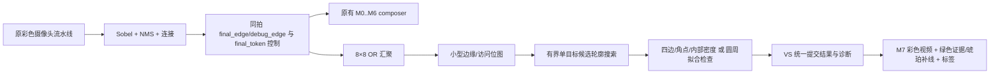

# V11-G1R：单目标轮廓识别与有界矩形补全

本版针对 G1 实板始终 NONE 的反馈重做候选提取与拒绝诊断。交付状态以 `reports/V11_G1R_VALIDATION.md` 为准。RTL 仿真和 Efinity 成功不能替代实板验收，也不能保证任意摄像头场景的准确率。

## 使用范围

中央半幅 ROI 内，一个较大、完整或局部断线的目标。矩形与正方形的边应大致水平、垂直；圆形应接近正对摄像头。支持位置和尺寸变化，暂不支持多目标输出、任意角度矩形、透视校正、椭圆识别或复杂背景下的通用检测。

默认 1920×1080 时，ROI 为 x=480..1439、y=270..809，M7 用短灰色角标提示范围。它不是识别框。目标应完整留在 ROI 内，并与角标留出至少一个 8 像素格的间隔。

识别在 8×8 OR 汇聚网格上工作。矩形包围框至少 8×8 格；圆形至少 12×12 格。实际展示建议目标短边/圆直径至少约 128 像素，避免量化使小菱形与小圆混淆。反投影的边界按网格量化，每边与真实边缘最多有约 7 像素差异。W/H 是这种包围框的像素尺寸，不是毫米测量。

## 实际数据路径



`img_pipeline.sv` 从 `final_edge` 及同拍 `final_token[43:40]` 取识别输入。叠加与原 RGB 一起经过现有 composer 寄存器，不增加原视频的周期延迟。没有用 composer 输出的延迟控制去配接更早的 `debug_edge`。

结果属于上一已完成输出帧，在下一 VS 提交；静止物体的框稳定，移动时会落后约一帧，量化也会使框以 8 像素步进。不把跨帧结果描述成零延迟跟踪。

复位后必须先见到 VS 才开始有效捕获。所有结果、框、四边支持掩码与诊断一起在帧边界发布。未完成、超时或溢出时输出 NONE、清零有效框；视频支路继续正常运行。

## 候选提取

旧版对整个 ROI 求一个全局框，零散噪点能直接扩大它。本版逐格搜索连通边缘，只保留最大的候选轮廓及次大轮廓的基本信息。

每格保存真实边缘与 visited 两位。工作队列和最佳候选队列各最多 2048 个真实占用格，入队即标记访问，使用同步块 RAM。沿八邻接搜索，另允许沿水平/垂直方向跨过最多两个空格连接。桥接只用于寻找同一个候选，绝不增加四边或圆周的真实支持点。

如果两个大小接近、互不包含的候选同时存在，输出 MULTI/NONE。队列溢出或计算超过 400,000 个像素时钟时输出 LIMIT/TIMEOUT，而不是截断轮廓后继续猜测。

这是有界的单目标候选搜索，不是完整多目标 CCL 输出系统，也不是完整 Hough。较大的背景轮廓可能成为最大候选并导致 NONE；相距很近的边缘也可能被汇聚/桥接合并。因此干净背景仍是本版使用条件，不能宣传为任意复杂场景识别。

## 矩形与补全

候选必须同时满足：

- 上下左右四条边分别至少 75% 的位置有真实边缘支持。
- 每边最大连续空段不超过 `max(2, 该边格数/5)`。
- 四个角的一格邻域内都存在真实支持；仅落在对角小格的圆弧不算交点，避免小圆被矩形分支先接受。
- 至少 80% 的候选点位于四边附近的两格宽边带；内部区域的占用率不超过 50%，拒绝密集纹理冒充方框。
- 长宽关系在允许范围；长宽差不超过较大边的 1/8 时显示 SQUARE，否则显示 RECT。

局部短缺口可以补出模型线段；整条边消失、角点缺乏证据或轮廓被严重遮挡时保持 NONE。搜索的两空格桥接上限与分类的连续缺口比例是两条不同规则：某条边有一个缺口时，其他三边也可能使轮廓保持连通，最后仍必须通过四边比例和缺口检查。

绿色显示有支持的矩形边及边带内的当前真实边缘。琥珀色虚线显示模型推断的短缺口。绿色模型线和琥珀线都基于上一帧结果；补线不会写回 Sobel/NMS/连接输出。

## 圆形

圆形使用候选中心、半径和真实点的半径一致性，要求至少 85% 的点落入量化容差环带、八个方向扇区都有支持、四向内部投影覆盖至少 90%、长宽比接近 1。圆形至少 12×12 格，避免分辨率不足时把菱形当圆。

圆形绘制绿色中心十字和 CIRCLE，不对缺失圆弧进行补圆。容差是对检测量化和少量缺点的容忍，不是对所有不完整形状都能拒绝的数学保证；回归包含圆弧负例。

## M7 诊断

第一行 `G1R CIRCLE/SQUARE/RECT/NONE 状态`。原有顶部 EGR 标识沿用，识别新版请看 M7 的 G1R。

| 状态 | 含义与处理 |
|---|---|
| OK | 通过形状检查 |
| WARMUP | 尚未收到完整且已同步的 ROI |
| NOEDGE | ROI 内没有有效边缘；先看 M2 及摄像头画面 |
| SIZE | 轮廓太小或接触 ROI 边界；调整位置与大小 |
| SHAPE | 角点、形状或圆周条件不符 |
| MULTI | 存在两个接近大小的独立候选；先只保留一个目标 |
| LIMIT | 候选点数超过队列容量，通常有密集干扰 |
| TIMEOUT | 在本帧预算内未完成计算；记录诊断再排查 |
| GAP | 四边覆盖或连续缺口条件不满足 |
| CLUTTER | 边带/内部密度或半径一致性不足 |

E 是 ROI 原始占用格数，N 是最佳候选占用格数；T/B/L/R 是四边支持的位置数，A 是径向内点数并在 255 饱和。这些诊断计数及 W/H 使用十六进制，页面标有 HEX；它们不是百分比。识别失败时有效框清零，W/H 显示零。

## 建议实板检查顺序

1. 使用本次独立固件，切 M7，确认画面有 G1R。KEY3 短按切页，长按切 PRE；M6 的按键含义沿用诊断页。
2. 可先用 PRE2、T=50 或你目前已经稳定的参数。先在 M2 确认目标轮廓实际存在；只有明显断裂时才小幅调整阈值。
3. 干净背景中放一个正对镜头的黑白方卡/矩形卡，短边在摄像头图像里约 128～320 像素，完整放入灰色角标内。先固定，再缓慢移动。
4. 依次用圆形、三角形、空白背景确认 CIRCLE、NONE、NONE。`test_cards` 提供可全屏显示/打印的 SVG。
5. 用局部断线矩形卡检查琥珀色补线，用缺整边卡检查保持 NONE。
6. 如果仍然 NONE，请记录第一行状态以及 E/N/T/B/L/R。该反馈能区分没有轮廓、候选选错、缺口过大和计算未完成。

没有实板反馈时，本版只能称为已通过对应离线测试和编译的实验固件。相机对焦、曝光、反光、运动模糊和拍摄透视仍会改变输入边缘；不能靠补线凭空恢复完全没有证据的目标。

## 构建与复现

```powershell
# 在本工程根目录；仿真脚本使用标准 Python 和工作区现有 Icarus。
python scripts/verify_g1r_cases.py --suite all
python scripts/verify_g1r_integration.py
.\scripts\build_g1r.ps1
python scripts/finalize_g1r.py
```

`build_g1r.ps1` 使用现有 Efinity 2026.1 和工作区接口工具，记录编译前源码清单，编译后核对源码未变化。`finalize_g1r.py` 核查测试源码哈希、最终布局时序、原工程校验和，才将对应 bit/hex 复制进 programming。

原始 `v11-gray-baseline` 和失败反馈对应的 `V11_G1` 保持独立；G1 的两个识别模块还保存在 `reference/G1_failed_revision` 供回归复现。
